<picture>
  <source media="(max-width: 600px)" srcset="./assets/banner-mobile.svg" />
  
</picture>

  <a href="https://Daniel040902.github.io/portafolio/"><strong>Portafolio ↗</strong></a>
  &nbsp; / &nbsp;
  <a href="#proyectos-destacados">Proyectos</a>
  &nbsp; / &nbsp;
  <a href="#github-en-números">Actividad</a>

Desarrollo **sistemas empresariales, APIs REST y aplicaciones móviles**, integrando interfaces, lógica de negocio y bases de datos. Trabajo también con contenedores, entornos virtualizados y configuración de entornos de desarrollo.

  <strong>Web y datos</strong> &nbsp; React · Laravel · PostgreSQL 
  <strong>Infraestructura</strong> &nbsp; Docker · Debian · Ubuntu · Linux 
  <strong>Móvil</strong> &nbsp; React Native · Expo

Josué Daniel Castillo Valverde · UNAN-León, Nicaragua

---

## <samp>Proyectos destacados</samp>

<table>
  <tr>
    <td width="50%" valign="top">
      <h3>BordaFamily</h3>
      
Catálogo digital para emprendimiento familiar: vitrina de productos, navegación fluida y diseño adaptable.

      
<code>React</code> <code>Tailwind</code> <code>Vercel</code>

      
      
    </td>
    <td width="50%" valign="top">
      <h3>Loto Centroamérica</h3>
      
Backend para consulta y administración de resultados de lotería de Centroamérica, con API y base de datos.

      
<code>Laravel</code> <code>PHP</code> <code>PostgreSQL</code>

      
    </td>
  </tr>
  <tr>
    <td width="50%" valign="top">
      <h3>Tienda de Conveniencia</h3>
      
Sistema de gestión comercial: ventas, inventario y control operativo en una interfaz moderna.

      
<code>React</code> <code>Laravel</code> <code>PostgreSQL</code>

      
    </td>
    <td width="50%" valign="top">
      <h3>Portafolio Personal</h3>
      
Mi carta de presentación digital: proyectos, habilidades y contacto con una experiencia visual futurista.

      
<code>JavaScript</code> <code>HTML</code> <code>CSS</code>

      
      
    </td>
  </tr>
</table>

---

## <samp>GitHub en números</samp>

 

---

## <samp>Tecnologías y entorno</samp>

<h4><samp>01 / SISTEMAS OPERATIVOS</samp></h4>

Debian 13 · Ubuntu · Linux · Windows 10/11

<h4><samp>02 / FRONTEND WEB</samp></h4>

React · JavaScript · HTML5 · CSS3 · Tailwind CSS · Vite

<h4><samp>03 / BACKEND Y BASES DE DATOS</samp></h4>

PHP · Laravel · APIs REST · PostgreSQL · SQL

<h4><samp>04 / APLICACIONES MÓVILES</samp></h4>

<h4><samp>05 / DEVOPS E INFRAESTRUCTURA</samp></h4>

Docker · Docker Compose · Nginx · Cloudflare · Cloudflare Tunnel

<h4><samp>06 / HERRAMIENTAS Y AUTOMATIZACIÓN</samp></h4>

Git · GitHub · GitHub Actions · CI/CD · Visual Studio Code · Terminal Linux · Bash

---

## <samp>Contribuciones</samp>

---

© 2026 Josué Daniel Castillo Valverde

